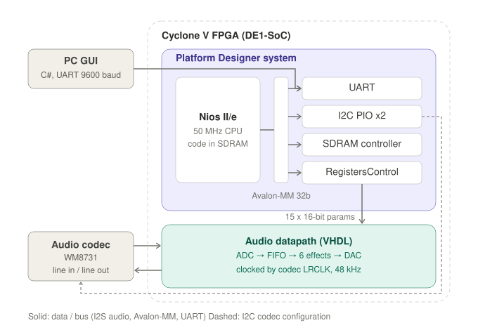
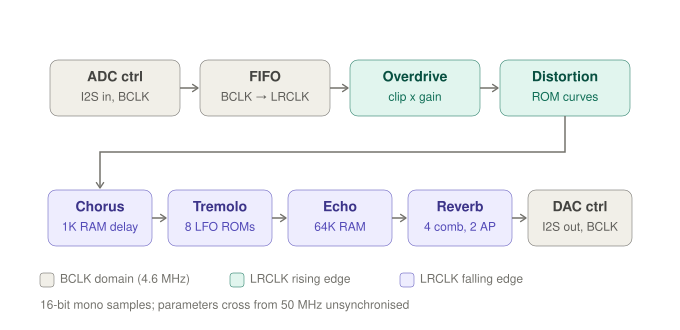
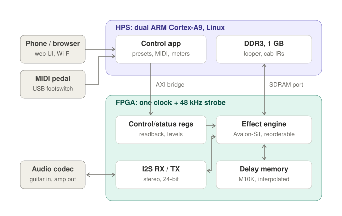

# Architecture

## 1. Current system

* **PC GUI → Nios II:** UART, 9600 baud 8N1, 3-byte command frames
  (see [register_map.md](register_map.md)), through a 3.3 V USB-UART adapter on GPIO_0.
* **Nios II/e** (50 MHz, program in the board's 64 MB SDRAM) reaches its
  peripherals over the **Avalon-MM** interconnect (32-bit). The peripherals are the UART, two PIOs
  that bit-bang **I²C** to the codec, the SDRAM controller and `RegistersControl`.
* **`RegistersControl`** holds 15 × 16-bit effect parameters and drives them as
  plain wires into the audio datapath.
* **Audio never passes through the CPU:** codec → I²S → VHDL datapath → I²S → codec.
  The Nios II only configures the codec and writes parameters.

## 2. Current audio datapath and clock domains

* 16-bit mono samples at 48 kHz. The processed left channel is sent to both DAC channels.
* The effects are clocked directly by the codec's `AUD_DACLRCLK` pin: overdrive and
  distortion on the rising edge, chorus, tremolo, echo and reverb on the falling edge
  (via `not(LRCLK)`). The serial I/O runs on BCLK, the ROM lookups on MCLK, and the
  parameters come from the 50 MHz Nios II domain without synchronisers.
* This multi-clock structure is the main architectural limitation, see
  [FIXES.md](FIXES.md#known-limitations-not-fixed-here).

## 3. Proposed v2 architecture

**Phase 2: a solid FPGA core** (same features, fully verifiable)

1. One clock domain with a one-cycle 48 kHz sample strobe; LRCLK/BCLK sampled as inputs.
2. New I²S core matching the codec's real 48-BCLK frame, stereo, 24-bit.
3. Shared fixed-point library (Q1.15/Q1.23 multiply, saturate, round, mix,
   parameter smoothing).
4. Better DSP blocks:
   * an NCO LFO instead of the 8 ROM tables;
   * interpolated delay lines, giving a smooth chorus plus flanger and vibrato;
   * a damped (Freeverb- or Dattorro-style) reverb;
   * level-compensated distortion curves.
5. Effects as Avalon-ST blocks with a runtime-reorderable chain.
6. Verification on cocotb + GHDL: Python golden models, WAV regression, GitHub Actions CI.

**Phase 3: a product on the DE1-SoC's HPS**

7. Linux control app on the ARM Cortex-A9. It provides a web UI (phone/browser),
   USB-MIDI footswitches, presets and level meters, and replaces the Nios II, the UART
   adapter and the C# GUI. It talks to the fabric through the HPS-to-FPGA AXI bridge.
8. New effects:
   * noise gate and compressor;
   * EQ / tone stack;
   * oversampled distortion;
   * phaser;
   * cabinet impulse responses;
   * a looper in DDR3;
   * an octaver.

Suggested order: step 6 first (fast, trustworthy tests), then 1–2, 3–5, then phase 3.
